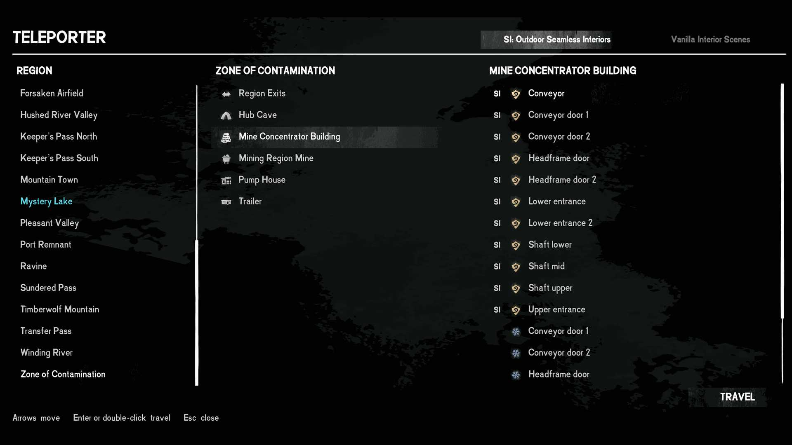

# Teleporter: details

Pick a destination in *The Long Dark* and travel there, with your inventory, clothing and the world intact.

This is a utility and cheat mod, built mostly as a tool for mod development and testing, and shared in case it is useful to others.

## Using it

Press `N` to open the teleporter. It has three columns: regions, the places in the selected region, and the doors of the selected place. Choose a door and press **Travel**, Enter, or double-click it. The game's own confirmation dialog asks before anything happens.

Arrows move, Enter or right steps into the next column, left steps back, and Escape closes the teleporter from anywhere.

## What you are offered

You are never sent to a building that is missing or burnt down in your world. Most destinations are offered only where the door and its arrival point exist in every survival world.

Some buildings, such as cabins, houses and trailers, share one interior that the game stores separately for each copy. For those the mod reads your own save to find the copy that actually stands there, so "Lake Cabin A" in Mystery Lake is three separate entries rather than one.

## How it travels

The mod places an invisible doorway at your feet, pointing at the destination, and lets the game travel through it exactly as if you had walked through a real door. The game only keeps your inventory, clothing and placed items when a scene change goes through its own door path; loading a scene directly treats the arrival as a new game. Nothing in this mod loads a scene itself, and no door in your world is changed.

## Settings

In the game's Mod Settings menu, under **Teleporter**:

- **Open teleporter key** and **Open teleporter modifier**: default `N` with no modifier. Mod Settings' key picker takes one key, so the modifier (None, Ctrl, Shift, Alt, or a pair) is chosen beside it. Exactly the chosen modifiers must be held. Change them if your own key bindings or another mod already use `N`.

## Known limits

- **Buildings in a region your save has never loaded are shown with a star and cannot be chosen yet.** The game has not given their doors an identity until the region is loaded once. Visit the region and they become available.
- **Some buildings ask you to step outside first.** The cabins, houses and trailers that appear in several places and look the same from outside can only be left through their own door, so the teleporter will not travel from inside them. See the README.
- **Arriving in the interior you are already standing in** is refused.
- **Iron Road** places are offered only when the game reports the DLC owned and usable. This has been tested only with the DLC owned.
- **Tales from the Far Territory** places are offered only when it is installed.
- The game is not paused while the teleporter is open. If an animal attacks or you die, it closes so the game can take over the screen.
- Survival mode only. The Wintermute story regions are not covered.

## Seamless Interiors

With **Seamless Interiors** installed, a building it takes over is reached the way that mod expects: the teleporter takes you to the building's region, waits for Seamless Interiors to finish loading, then opens the building's own door for you. The selector at the top of the teleporter switches between Seamless Interiors' buildings and the game's own interior scenes. Travelling away from inside one of its buildings works like travelling from anywhere outdoors.

## Installation

Download `Teleporter.dll` from the [latest release](https://github.com/JesseWV/TLD-Teleporter/releases/latest) and put it in the game's `Mods` folder.

## Building from source

Copy `ModSettings.dll` from the game's `Mods` folder into a `lib` folder beside `Teleporter.csproj`, then run `dotnet build Teleporter.csproj -c Release`. The game assemblies come from NuGet.
