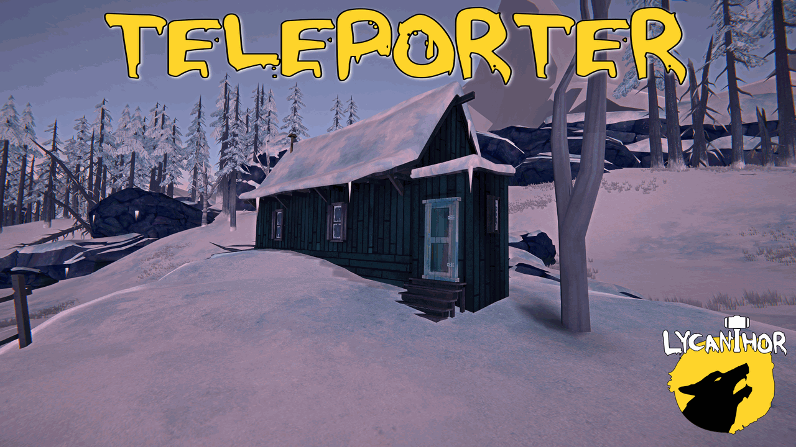
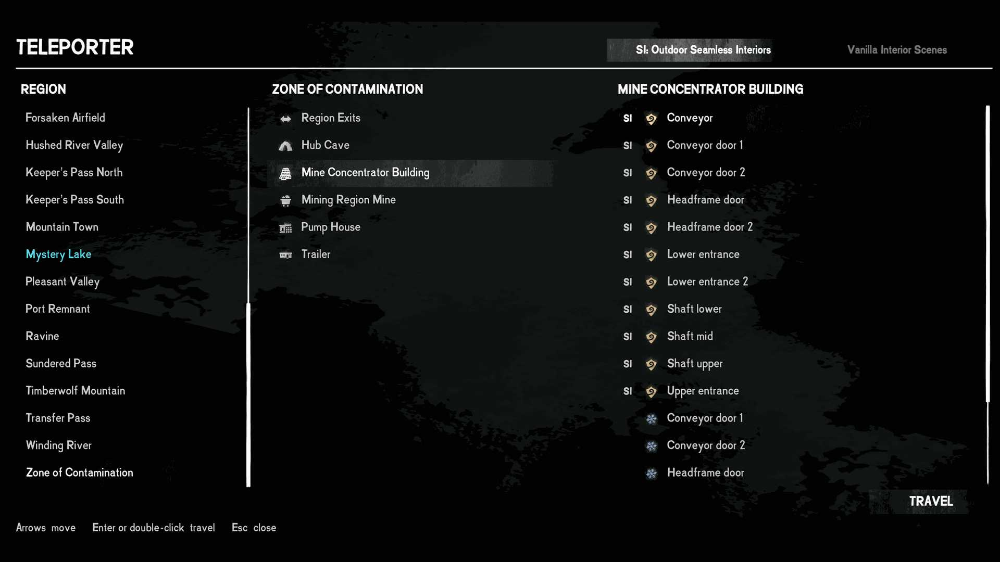

# Teleporter

## Pick any existing game destination from the menu and travel there instantly!

*This is a utility mod, built mostly as a tool for mod development and testing, and shared in case it is useful to others. Using it for regular gameplay would be consider as a cheat which is why it's categorized as such.*

Press `N` to open it. Choose a region, a place, then a door, and confirm. Survival mode only.

⚠️ Back up your saves first!

##### Teleporter may ask you to step outside

Many of the game's smaller buildings, such as the cabins around Mystery Lake, some houses and the trailers, appear in several places and look the same from outside. The game keeps one copy of that interior and fills it with the contents of whichever building you walked into.

From inside one of these buildings, the game can only take you back out through the door you came in. It cannot send you anywhere else. So the teleporter will not travel from inside them, and asks you to step outside first. Walk out the door, open the teleporter again, and travel from there.

This does not apply with Seamless Interiors installed. Its buildings are part of the region itself, so you can travel from inside them as from anywhere outdoors.

More detail is in [DETAILS.md](DETAILS.md).

Requires: The Long Dark 2.58, MelonLoader 0.7.2, [ModSettings](https://github.com/DigitalzombieTLD/ModSettings).

Compatible with Seamless Interiors
